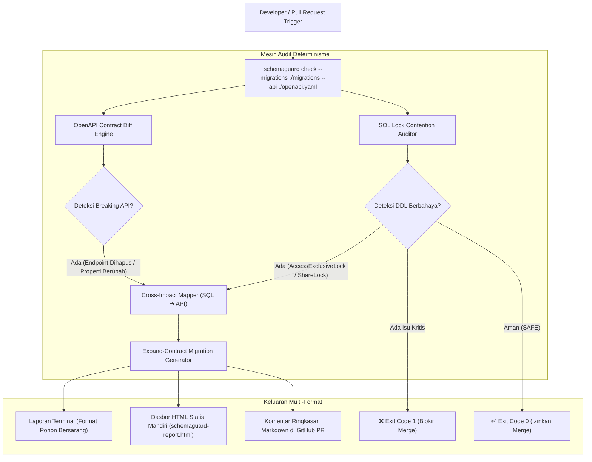

# 🛡️ SchemaGuard

> **Perkakas Audit Statis Migrasi Basis Data (DDL Lock Contention) dan Kompatibilitas Kontrak API (OpenAPI) dengan Rekomendasi Pola Expand-Contract.**

[](https://github.com/ChoqySirait/schemaguard/actions/workflows/ci.yml)
[](LICENSE)
[](https://www.typescriptlang.org/)
[](https://nodejs.org/)
[](#-pengujian-unit)

---

## 📌 Latar Belakang Masalah Industri

Di lingkungan teknologi berskala tinggi (*high-traffic engineering*), perubahan skema basis data dan kontrak API sering kali lolos dari peninjauan kode manual (*code review*), memicu dua insiden pemadaman kritis (*cascading outage*):

1. **Downtime Akibat Kunci Tabel Eksklusif (*DDL Lock Contention*)**:
   - Pernyataan DDL seperti `ALTER COLUMN TYPE`, `DROP COLUMN`, `RENAME TABLE`, atau `ADD NOT NULL` tanpa nilai bawaan mengakuisisi **`AccessExclusiveLock`** di PostgreSQL atau **`Metadata Lock (MDL)`** di MySQL.
   - Mode penguncian ini memblokir seluruh kueri baca dan tulis (`SELECT`, `INSERT`, `UPDATE`, `DELETE`). Akibatnya, transaksi antrean menumpuk, kolam koneksi (*connection pool*) jenuh dalam hitungan detik, dan layanan mengalami kehabisan batas waktu (*timeout*).
   - *Referensi*: [PostgreSQL Explicit Locking Documentation](https://www.postgresql.org/docs/current/explicit-locking.html).

2. **Pemutusan Kontrak API Diam-Diam (*Silent Breaking API Changes*)**:
   - Menghapus kolom atau mengubah tipe data kolom SQL secara langsung merusak serialisasi JSON pada endpoint OpenAPI yang dikonsumsi oleh aplikasi web, seluler, atau mitra integrasi pihak ketiga.
   - Solusi industri standar untuk menghindari pemadaman ini adalah menerapkan **Pola Expand & Contract** (*Parallel Change*).
   - *Referensi*: [Martin Fowler — Parallel Change (Expand and Contract Pattern)](https://martinfowler.com/bliki/ParallelChange.html) & [Stripe Engineering — Online Migrations at Scale](https://stripe.com/blog/online-migrations).

**SchemaGuard** hadir sebagai penjaga gerbang kualitas deterministik untuk mengidentifikasi anomali penguncian, memetakan keterkaitan dampak (*Cross-Impact Mapping*), dan menyusun draf strategi mitigasi transisi aman sebelum kode digabungkan ke cabang produksi.

---

## 🏗️ Alur Kerja Sistem (Workflow Architecture)



---

## ✨ Fitur Utama

1. **Audit Migrasi SQL & Deteksi Kunci Tabel**:
   - Parser deterministik yang sadar terhadap batas string literal dan komentar SQL (`--`, `/* ... */`).
   - Mendeteksi dialek PostgreSQL & MySQL dengan klasifikasi mode penguncian:
     - `ACCESS_EXCLUSIVE` (memblokir baca/tulis penuh).
     - `SHARE_ROW_EXCLUSIVE` & `SHARE` (memblokir penulisan konkuren).
     - `METADATA_LOCK` (penguncian tabel pada MySQL).

2. **Validasi Kompatibilitas OpenAPI**:
   - Mendukung spesifikasi OpenAPI 3.x dan Swagger 2.0 (format JSON/YAML).
   - Mendukung resolusi skema komponen lokal (`$ref: '#/components/schemas/...'`) dan skema item dalam array.
   - Mendeteksi rute/metode yang dihapus, penambahan parameter wajib baru, penghapusan kode status 2xx, dan perubahan tipe properti respons.

3. **Pelacakan Dampak Silang (*Cross-Impact Mapping*)**:
   - Memetakan korelasi langsung antara modifikasi kolom SQL (`DROP_COLUMN`, `ALTER_COLUMN_TYPE`, `RENAME_COLUMN`) dengan properti respons API.
   - Mendukung normalisasi penamaan (`snake_case` di basis data ke `camelCase` di kontrak JSON API).

4. **Generator Mitigasi Zero-Downtime (Expand & Contract)**:
   - Menyusun skrip SQL dua fase:
     - **Fase 1 (Expand)**: Kolom bayangan (*shadow column*), pemasangan pemicu sinkronisasi (*dual-writing trigger*), batch backfill bertahap (1.000–5.000 baris berpaginasi), atau penambahan batasan dengan klausul `NOT VALID`.
     - **Fase 2 (Contract)**: Pengalihan kueri baca, pembersihan pemicu dan kolom lama, serta validasi constraint terpisah.

5. **Laporan Visual HTML Mandiri (*Offline-Ready*)**:
   - Menghasilkan berkas dasbor visual `schemaguard-report.html` (dark-mode, responsif, tanpa dependensi server atau CDN luar).

---

## ⚡ Panduan Cepat (Quickstart)

### 1. Instalasi
```bash
# Clone repositori
git clone https://github.com/ChoqySirait/schemaguard.git
cd schemaguard

# Pasang dependensi dan kompilasi
npm install
npm run build
```

### 2. Jalankan Demonstrasi Satu Perintah
SchemaGuard telah dilengkapi dengan berkas sampel nyata di direktori `examples/`:
```bash
npm run demo
```

Perintah di atas akan memindai migrasi SQL pada `examples/` dan kontrak `examples/openapi.yaml`, mencetak ringkasan pohon di konsol terminal, dan menghasilkan berkas laporan visual HTML mandiri `schemaguard-report.html`.

---

## 💻 Penggunaan Baris Perintah (CLI)

SchemaGuard menyediakan antarmuka CLI yang intuitif dan kaya opsi:

```bash
# Audit migrasi DDL dan kontrak OpenAPI sekaligus
schemaguard check \
  --migrations ./migrations \
  --api ./openapi.yaml \
  --html-report ./schemaguard-report.html \
  --fail-on CRITICAL
```

### Opsi Argumen Baris Perintah:
| Opsi | Deskripsi | Default |
| :--- | :--- | :---: |
| `-m, --migrations <path>` | Jalur direktori atau berkas migrasi SQL | - |
| `-a, --api <path>` | Jalur berkas spesifikasi OpenAPI (YAML/JSON) | - |
| `--api-base <path>` | Berkas OpenAPI referensi cabang utama (lama) | - |
| `--api-head <path>` | Berkas OpenAPI cabang kerja (baru) | - |
| `--db-base <path>` | Berkas skema SQL cabang utama (base) | - |
| `--db-head <path>` | Berkas skema SQL cabang kerja (head) | - |
| `--html-report <path>` | Simpan laporan visual HTML mandiri (*offline-ready*) | - |
| `--format <type>` | Format keluaran terminal (`console`, `json`, `html`, `markdown`) | `console` |
| `-o, --output <path>` | Jalur penyimpanan berkas keluaran laporan | - |
| `--fail-on <level>` | Ambang batas kegagalan exit code (`CRITICAL` atau `WARNING`) | `CRITICAL` |

---

## 🖥️ Contoh Tampilan Keluaran Terminal

SchemaGuard menyajikan ringkasan konsol menggunakan struktur pohon bersarang (*tree format*) yang padat dan informatif:

```text
Laporan visual HTML berhasil disimpan ke: ./schemaguard-report.html

🛡️  SCHEMAGUARD AUDIT:  [BLOCKED] KRITIS  (Total 3 isu)
Skor Risiko: TINGGI (Downtime/Breaking) │ DDL Berisiko: 3 │ API Terdampak: 2
────────────────────────────────────────────────────────────────────────────────
🗄️  STRUKTUR HIERARKI TEMUAN PENGUNCIAN & DAMPAK API:
📦 users (Tabel)
  ├── 🔴 Drop Column Statement [avatar_url] (ACCESS_EXCLUSIVE lock)
  │   └── 🔗 GET /api/users (properti 'avatar_url')
  └── 🔴 Alter Column Type [age] (ACCESS_EXCLUSIVE lock)
      └── 🔗 GET /api/users (properti 'age')

📦 orders (Tabel)
  └── 🟡 Non-concurrent Index Creation [idx_orders_user] (SHARE lock)

⚠ Kontrak berkas OpenAPI tidak mengalami perubahan langsung, namun terdapat 2 endpoint yang terancam rusak akibat perubahan skema SQL.

🛡️  PANDUAN LANGKAH MITIGASI RINGKAS (EXPAND & CONTRACT):
  1. users.avatar_url:
     • Expand  : Hentikan akses pada kode aplikasi terlebih dahulu, jadikan nullable/deprecated.
     • Contract: Hapus fisik dari basis data setelah 100% armada rilis baru beroperasi.
  2. users.age:
     • Expand  : Tambah kolom bayangan ➔ pasang pemicu dual-write ➔ backfill bertahap (1k-5k baris/batch).
     • Contract: Alihkan kueri baca ke kolom baru ➔ bersihkan pemicu & kolom lama ➔ ganti nama definitif.
  3. orders (idx_orders_user):
     • Tindakan: Buat indeks di luar blok transaksi tunggal menggunakan mode non-pemblokiran (CONCURRENTLY).

────────────────────────────────────────────────────────────────────────────────
📄 Buka laporan lengkap & skrip SQL mandiri : file://./schemaguard-report.html
💡 Lewati aturan jika terbukti aman         : schemaguard check --ignore-rule <id>
────────────────────────────────────────────────────────────────────────────────
```

---

## 🤖 Integrasi Alur Kerja GitHub Actions CI/CD

Integrasikan SchemaGuard sebagai gerbang kualitas (*Quality Gate*) otomatis pada berkas `.github/workflows/schemaguard.yml`:

```yaml
name: SchemaGuard Quality Gate

on:
  pull_request:
    branches: [ main, master ]

jobs:
  audit:
    name: Schema & API Audit
    runs-on: ubuntu-latest
    permissions:
      contents: read
      pull-requests: write

    steps:
      - name: Checkout Repositori
        uses: actions/checkout@v4

      - name: Pasang Node.js
        uses: actions/setup-node@v4
        with:
          node-version: 20
          cache: 'npm'

      - name: Pasang Dependensi
        run: npm ci

      - name: Jalankan Audit SchemaGuard
        run: |
          npx schemaguard check \
            --migrations ./migrations \
            --api ./openapi.yaml \
            --html-report ./schemaguard-report.html \
            --fail-on CRITICAL

      - name: Unggah Artefak Laporan Visual
        if: always()
        uses: actions/upload-artifact@v4
        with:
          name: schemaguard-audit-report
          path: ./schemaguard-report.html
```

---

## 🧪 Pengujian Unit

SchemaGuard diverifikasi dengan **56 skenario pengujian unit ketat** menggunakan [Vitest](https://vitest.dev/):

```bash
# Menjalankan seluruh rangkaian tes
npm test

# Menjalankan pengujian per modul
npx vitest run tests/sqlDiff.test.ts        # 23 tests (Parser DDL, Lock Modes, Dialect Filters)
npx vitest run tests/apiDiff.test.ts        # 15 tests (OpenAPI diff, $ref resolving, Cross-Impact)
npx vitest run tests/recommender.test.ts    # 18 tests (Expand-Contract templates & recommendations)
```

---

## 📚 Referensi Praktik Rekayasa Industri

- **PostgreSQL Explicit Locking**: https://www.postgresql.org/docs/current/explicit-locking.html
- **Martin Fowler — Parallel Change (Expand and Contract)**: https://martinfowler.com/bliki/ParallelChange.html
- **Stripe Engineering — Online Migrations at Scale**: https://stripe.com/blog/online-migrations
- **GitLab Database Guides — Zero-Downtime Migrations**: https://docs.gitlab.com/ee/development/database/avoiding_downtime_in_migrations.html

---

## 📄 Lisensi

Proyek ini didistribusikan di bawah lisensi **MIT**. Hak Cipta © 2026 SchemaGuard Contributors. Lihat berkas [LICENSE](LICENSE) untuk informasi lebih lanjut.
