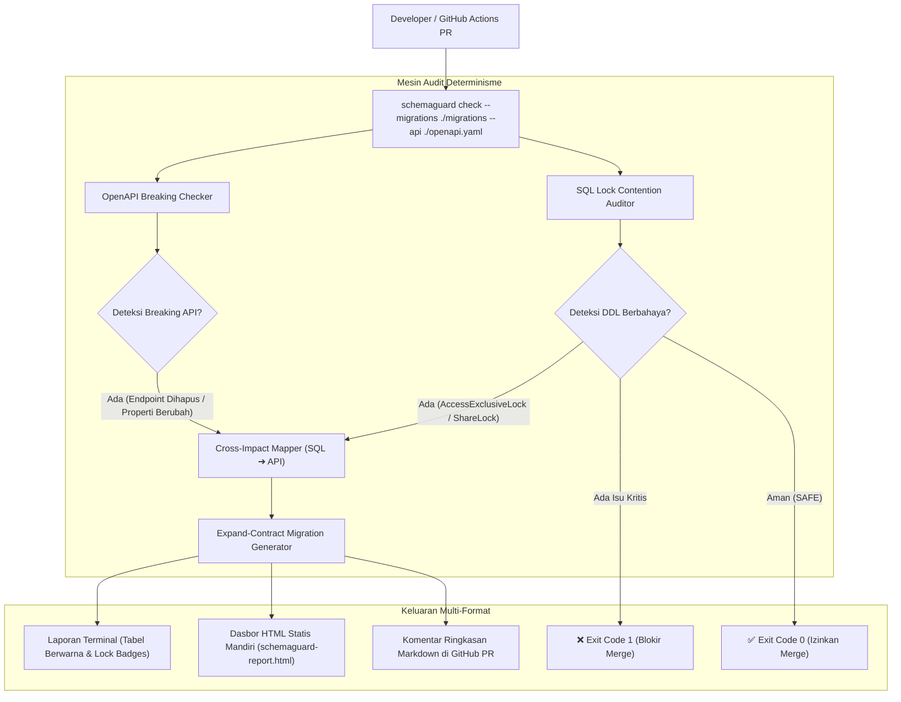

# 🛡️ SchemaGuard

> **Perkakas Audit Statis Migrasi Basis Data (DDL Lock Contention) dan Kompatibilitas Kontrak API (OpenAPI) dengan Rekomendasi Pola Expand-Contract.**

[](https://opensource.org/licenses/MIT)
[](https://www.typescriptlang.org/)
[](https://nodejs.org/)
[](#pengujian-unit)
[](#integrasi-github-action)

---

## 📌 Masalah Rekayasa Nyata (Real Engineering Context)

Di perusahaan teknologi modern, perubahan skema basis data dan kontrak API sering kali lolos dari peninjauan kode manual (*code review*), memicu dua insiden pemadaman kritis di produksi:

1. **Downtime Akibat Kunci Tabel (*Lock Contention*)**:
   - Perintah DDL seperti `ALTER COLUMN TYPE`, `DROP COLUMN`, `RENAME TABLE`, atau `ADD NOT NULL` tanpa nilai bawaan mengakuisisi **`AccessExclusiveLock`** di PostgreSQL atau **`Metadata Lock (MDL)`** di MySQL.
   - Kunci ini memblokir seluruh operasi baca dan tulis (`SELECT`, `INSERT`, `UPDATE`, `DELETE`), mengantrekan koneksi *connection pool*, dan berujung pada kehabisan batas waktu (*connection timeout*) dan *cascading outage*.
2. **Pemutusan Kontrak API (*Breaking API Changes*)**:
   - Modifikasi atau penghapusan kolom SQL secara diam-diam memutus properti JSON yang sedang dikonsumsi oleh aplikasi web, seluler, atau layanan pihak ketiga.

**SchemaGuard** menganalisis perbedaan skema secara statis dan deterministik pada alur kerja pengembang lokal maupun CI/CD Pull Request, memblokir perubahan berisiko, memetakan korelasi silang (**Cross-Impact Mapping**), serta menghasilkan draf skrip mitigasi transisi aman dua fase (**Expand and Contract**).

---

## 🏗️ Alur Kerja Sistem (Developer Workflow)



---

## ✨ Fitur Utama

1. **SQL Migration & Lock Contention Auditor**:
   - Menganalisis sintaksis DDL PostgreSQL dan MySQL secara statis tanpa mengeksekusi kueri ke basis data nyata.
   - Sadar konteks string literal dan komentar SQL (`--` dan `/* ... */`).
   - Mendeteksi mode penguncian berbahaya:
     - `ACCESS_EXCLUSIVE` (memblokir seluruh SELECT, INSERT, UPDATE, DELETE).
     - `SHARE_ROW_EXCLUSIVE` & `SHARE` (memblokir modifikasi konkuren selama verifikasi constraint atau indeks dibuat).
     - `METADATA_LOCK` (DDL blocking pada MySQL).

2. **OpenAPI Breaking Changes Detector**:
   - Membandingkan dokumen OpenAPI 3.x dan Swagger 2.0 (format JSON/YAML).
   - Mendukung resolusi referensi komponen rekursif (`$ref: '#/components/schemas/...'`).
   - Mendeteksi penghapusan rute, penghapusan metode HTTP, penambahan parameter wajib (`required: true`), perubahan skema array items, dan perubahan tipe properti respons.

3. **Cross-Impact Mapping (SQL ➔ API)**:
   - Memetakan korelasi langsung antara modifikasi kolom SQL (seperti `DROP COLUMN` atau `ALTER COLUMN TYPE`) dengan properti respons pada endpoint OpenAPI.
   - Mendukung penyesuaian konvensi penamaan (`snake_case` di SQL ke `camelCase` di kontrak API).

4. **Expand and Contract Migration Generator**:
   - Menghasilkan cetak biru skrip dua fase (*zero-downtime*):
     - **Fase 1 (Expand)**: Kolom bayangan (*shadow column*), batch backfill, trigger sinkronisasi ganda (*dual-write*), atau penambahan batasan dengan flag `NOT VALID`.
     - **Fase 2 (Contract)**: Pengalihan pembacaan, validasi constraint asinkron, dan pembersihan kolom lama setelah seluruh pod aplikasi selesai dirilis.

5. **Self-Contained Standalone HTML Report**:
   - Menghasilkan berkas dasbor visual `schemaguard-report.html` (dark-mode, responsif, dan 100% mandiri tanpa dependensi CDN luar).

---

## 💻 Penggunaan Baris Perintah (CLI)

### 1. Perintah Standar Audit Rekayasa (`check`)
```bash
# Audit migrasi DDL dan kontrak OpenAPI sekaligus, serta buat laporan HTML
schemaguard check \
  --migrations ./migrations \
  --api ./openapi.yaml \
  --html-report ./schemaguard-report.html \
  --fail-on CRITICAL
```

### 2. Memeriksa Migrasi Basis Data Saja (`check-db`)
```bash
# Pindai seluruh berkas SQL dalam direktori migrasi
schemaguard check-db --migrations ./migrations

# Pindai berkas SQL tunggal
schemaguard check-db --file ./migrations/003_alter_orders.sql

# Bandingkan perbedaan skema cabang utama (base) terhadap cabang fitur (head)
schemaguard check-db --base ./schema_base.sql --file ./schema_head.sql
```

### 3. Memeriksa Kompatibilitas Kontrak API Saja (`check-api`)
```bash
# Bandingkan spesifikasi OpenAPI cabang produksi (base) terhadap cabang fitur (head)
schemaguard check-api --base ./api/v1.yaml --head ./api/v2.yaml
```

#### Opsi Argumen CLI:
| Opsi | Deskripsi Singkat | Nilai Default |
| :--- | :--- | :---: |
| `-m, --migrations <path>` | Jalur berkas atau direktori migrasi SQL | - |
| `-a, --api <path>` | Jalur berkas spesifikasi OpenAPI (YAML/JSON) | - |
| `--api-base <path>` | Berkas OpenAPI referensi cabang utama (base) | - |
| `--api-head <path>` | Berkas OpenAPI cabang fitur kerja (head) | - |
| `--db-base <path>` | Berkas skema SQL cabang utama (base) | - |
| `--db-head <path>` | Berkas skema SQL cabang fitur kerja (head) | - |
| `--html-report <path>` | Simpan laporan visual HTML mandiri (*offline-ready*) | - |
| `--format <type>` | Format keluaran terminal (`console`, `json`, `html`, `markdown`) | `console` |
| `-o, --output <path>` | Jalur penyimpanan berkas keluaran laporan | - |
| `--fail-on <level>` | Ambang batas exit code gagal (`CRITICAL` atau `WARNING`) | `CRITICAL` |

---

## 📋 Katalog Aturan Deteksi (Rulebook)

### 1. Aturan Penguncian Skema SQL (DDL Lock Rules)
| ID Aturan | Tingkat Risiko | Mode Penguncian | Deskripsi Rekayasa |
| :--- | :---: | :---: | :--- |
| `DROP_TABLE` | 🔴 `CRITICAL` | `ACCESS_EXCLUSIVE` | Menghapus tabel fisik, memutus seluruh transaksi aktif, dan berisiko kehilangan data permanen. |
| `DROP_COLUMN` | 🔴 `CRITICAL` | `ACCESS_EXCLUSIVE` | Memerlukan lock eksklusif dan menggagalkan aplikasi versi sebelumnya yang masih membaca/menulis kolom. |
| `ALTER_COLUMN_TYPE` | 🔴 `CRITICAL` | `ACCESS_EXCLUSIVE` | Memicu *table rewrite* penuh dan mengunci tabel sepanjang proses konversi baris data. |
| `RENAME_COLUMN` | 🔴 `CRITICAL` | `ACCESS_EXCLUSIVE` | Memutus kueri `INSERT` / `SELECT` pada pod aplikasi yang belum diperbarui. |
| `ADD_NOT_NULL_WITHOUT_DEFAULT` | 🔴 `CRITICAL` | `ACCESS_EXCLUSIVE` | Menggagalkan operasi penulisan dari aplikasi versi lama yang belum menyediakan nilai kolom baru. |
| `RENAME_TABLE` | 🔴 `CRITICAL` | `ACCESS_EXCLUSIVE` | Memutus semua rute kueri sebelum VIEW kompatibilitas disediakan. |
| `CREATE_INDEX_NON_CONCURRENTLY` | 🟡 `WARNING` | `SHARE` | Menahan operasi tulis (`INSERT`/`UPDATE`/`DELETE`) selama proses pengindeksan berlangsung. Gunakan `CONCURRENTLY`. |
| `ADD_COLUMN_WITH_DEFAULT` | 🟡 `WARNING` | `ACCESS_EXCLUSIVE` | Menambahkan default dinamis (seperti `now()` atau `random()`) memicu evaluasi baris demi baris dan penguncian panjang. |
| `VALIDATE_CONSTRAINT` | 🟡 `WARNING` | `SHARE_ROW_EXCLUSIVE` | Menambahkan CHECK / FOREIGN KEY constraint tanpa `NOT VALID` memicu pemindaian tabel penuh yang menahan operasi tulis. |

### 2. Aturan Perubahan Merusak API (OpenAPI Breaking Rules)
| ID Aturan | Tingkat Risiko | Deskripsi Dampak |
| :--- | :---: | :--- |
| `ENDPOINT_REMOVED` | 🔴 `CRITICAL` | Rute dihapus dari spesifikasi; klien menerima HTTP 404 Not Found. |
| `METHOD_REMOVED` | 🔴 `CRITICAL` | Metode HTTP dihapus dari rute; klien menerima HTTP 405 Method Not Allowed. |
| `REQUIRED_PARAMETER_ADDED` | 🔴 `CRITICAL` | Parameter wajib baru memicu galat HTTP 400 Bad Request pada aplikasi klien lama. |
| `RESPONSE_SCHEMA_CHANGED` | 🔴 `CRITICAL` | Penghapusan properti respons menyebabkan kegagalan *deserialization* data di klien. |
| `STATUS_CODE_REMOVED` | 🔴 `CRITICAL` | Kode status respons sukses (2xx) yang dihapus memicu *unhandled error* pada klien. |
| `PROPERTY_TYPE_CHANGED` | 🔴 `CRITICAL` | Perubahan tipe data (misal: number ke string) memicu *runtime type error* di klien. |

---

## 🤖 Integrasi Alur Kerja GitHub Actions CI/CD

Integrasikan SchemaGuard sebagai gerbang kualitas (*quality gate*) pada berkas `.github/workflows/schemaguard.yml`:

```yaml
name: SchemaGuard Quality Gate

on:
  pull_request:
    branches: [ main, master ]

jobs:
  audit:
    runs-on: ubuntu-latest
    permissions:
      contents: read
      pull-requests: write

    steps:
      - name: Checkout Repositori
        uses: actions/checkout@v4

      - name: Pasang Node.js
        uses: actions/setup-node@v4
        with:
          node-version: 20

      - name: Jalankan Audit SchemaGuard
        run: |
          npx schemaguard check \
            --migrations ./migrations \
            --api ./openapi.yaml \
            --html-report ./schemaguard-report.html \
            --fail-on CRITICAL

      - name: Unggah Artefak Laporan Visual
        if: always()
        uses: actions/upload-artifact@v4
        with:
          name: schemaguard-html-report
          path: ./schemaguard-report.html
```

---

## 🧪 Pengujian Unit

SchemaGuard diverifikasi dengan 56 skenario pengujian unit ketat menggunakan **Vitest**:

```bash
# Menjalankan seluruh pengujian unit
npm test

# Menjalankan pengujian spesifik per domain
npx vitest run tests/sqlDiff.test.ts        # 23 tests (DDL parser, lock contention, dialect filter)
npx vitest run tests/apiDiff.test.ts        # 15 tests (OpenAPI diff, $ref resolving, cross-impact)
npx vitest run tests/recommender.test.ts    # 18 tests (Expand-Contract templates & recommendations)
```

---

## 📚 Referensi Praktik Rekayasa Industri

- **PostgreSQL Explicit Locking Documentation**: https://www.postgresql.org/docs/current/explicit-locking.html
- **Martin Fowler — Parallel Change (Expand and Contract Pattern)**: https://martinfowler.com/bliki/ParallelChange.html
- **Stripe Engineering — Online Migrations at Scale**: https://stripe.com/blog/online-migrations
- **GitLab Database Migration Guides**: https://docs.gitlab.com/ee/development/database/avoiding_downtime_in_migrations.html

---

## 📄 Lisensi

Proyek ini dirilis di bawah lisensi **MIT**. Hak Cipta © 2026 SchemaGuard Contributors.
