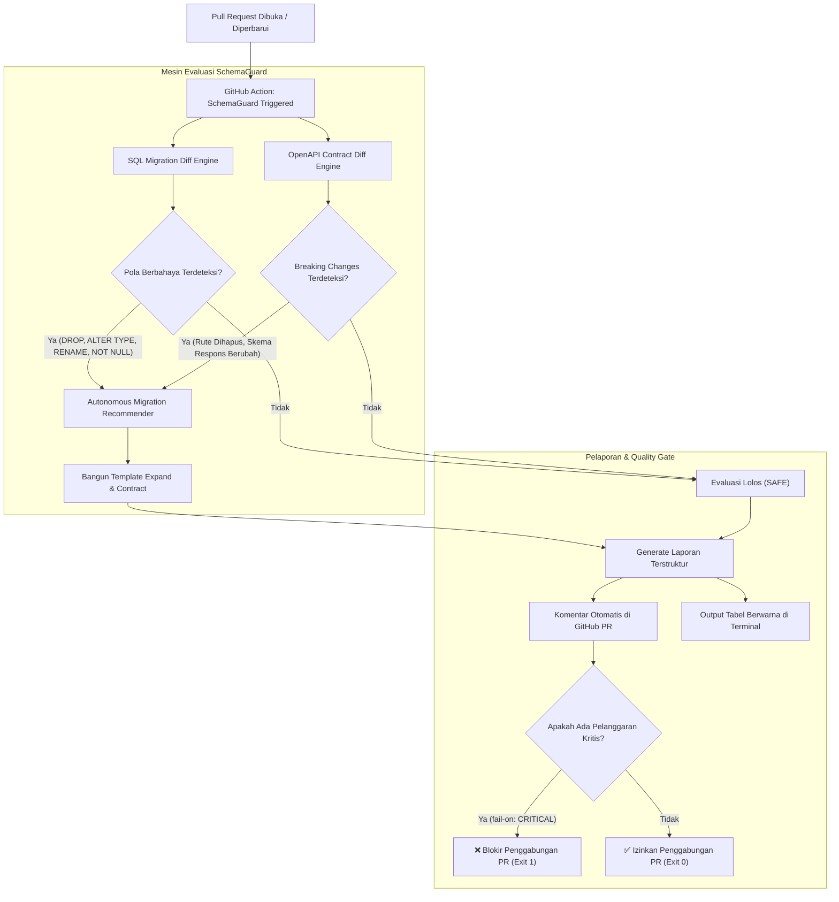

# 🛡️ SchemaGuard

> **Penjaga Kualitas Skema Basis Data dan Kontrak API dengan Rekomendasi Mitigasi Bertahap (*Zero-Downtime Migration*).**

[](https://opensource.org/licenses/MIT)
[](https://www.typescriptlang.org/)
[](https://nodejs.org/)
[](#integrasi-github-action)

---

## 📌 Ringkasan Eksekutif

**SchemaGuard** adalah perkakas baris perintah (CLI) dan aksi CI/CD GitHub Action yang berfungsi mendeteksi perubahan berbahaya (*breaking changes*) pada migrasi basis data SQL serta spesifikasi antarmuka pemrograman aplikasi (OpenAPI/Swagger) secara statis dan deterministik.

Alih-alih sekadar memblokir penggabungan kode (*Pull Request*), SchemaGuard secara proaktif menghasilkan **skrip mitigasi pola *Expand and Contract*** dua fase agar layanan aplikasi versi lama dan baru dapat berjalan berdampingan di lingkungan produksi tanpa waktu henti (*zero-downtime*).

---

## 🏗️ Diagram Alur Kerja Sistem



---

## ✨ Fitur Utama

1. **Database Migration Diff Engine**:
   - Memindai skrip migrasi SQL secara statis tanpa mengeksekusi kueri ke basis data nyata.
   - Mendeteksi operasi berbahaya:
     - `DROP TABLE`
     - `DROP COLUMN`
     - `ALTER COLUMN TYPE`
     - `RENAME COLUMN`
     - `ADD NOT NULL` tanpa nilai default
     - `CREATE INDEX` tanpa mode non-pemblokiran (`CONCURRENTLY`)
     - `RENAME TABLE`
   - Memberikan evaluasi tingkat risiko: **CRITICAL**, **WARNING**, dan **SAFE**.

2. **API Contract Compatibility Engine**:
   - Membandingkan dua dokumen spesifikasi OpenAPI 3.x / Swagger 2.0 (format JSON atau YAML).
   - Mendeteksi perubahan merusak pada integrasi klien:
     - Penghapusan rute (*Endpoint Removed*)
     - Penghapusan metode HTTP (*Method Removed*)
     - Penambahan parameter wajib (*Required Parameter Added*)
     - Perubahan atau penghapusan tipe properti respons (*Response Schema Changed*)
     - Penghapusan kode status keberhasilan (*Status Code Removed*)

3. **Autonomous Migration Recommender (Pola Expand & Contract)**:
   - Menghasilkan rekomendasi skrip dua fase secara otomatis:
     - **Fase Perluas (*Expand*)**: Penambahan kolom baru, pengarsipan, pembuatan VIEW jembatan, penulisan ganda (*dual-write*), atau header deprecation API.
     - **Fase Susutkan (*Contract*)**: Penghapusan kolom/tabel fisik lama setelah seluruh aplikasi aktif bermigrasi penuh.
   - Menyertakan daftar periksa transisi (*checklist*) untuk tim perekayasa perangkat lunak.

4. **Multi-Format Reporting & GitHub Commenter**:
   - Visualisasi tabel konsol terminal berwarna dengan *badges* risiko.
   - Pembuatan ringkasan Markdown interaktif yang langsung disematkan ke komentar Pull Request GitHub.

---

## 🚀 Panduan Instalasi

### Prasyarat
- **Node.js**: Versi `20.x` atau lebih baru
- **npm** atau **pnpm**

### Instalasi Lokal
```bash
# Clone repositori
git clone https://github.com/ChoqySirait/schemaguard.git
cd schemaguard

# Pasang dependensi
npm install

# Kompilasi TypeScript
npm run build

# Tautkan secara global (opsional)
npm link
```

---

## 💻 Penggunaan Baris Perintah (CLI)

SchemaGuard menyediakan antarmuka CLI yang intuitif:

### 1. Memindai Migrasi Basis Data (`check-db`)
```bash
# Pindai berkas migrasi SQL tunggal
schemaguard check-db --file migrations/003_drop_column.sql

# Pindai seluruh berkas migrasi dalam satu direktori
schemaguard check-db --dir ./migrations

# Bandingkan skema cabang kerja terhadap skema cabang utama
schemaguard check-db --base schema_base.sql --file schema_head.sql
```

### 2. Memeriksa Kompatibilitas Kontrak API (`check-api`)
```bash
# Bandingkan berkas spesifikasi OpenAPI format YAML atau JSON
schemaguard check-api --base api/v1.yaml --head api/v2.yaml
```

### 3. Pemindaian Komprehensif Penuh (`scan`)
```bash
# Jalankan audit gabungan migrasi basis data dan spesifikasi API
schemaguard scan \
  --sql-dir ./migrations \
  --api-base api/base.yaml \
  --api-head api/head.yaml \
  --format console \
  --fail-on CRITICAL
```

#### Opsi Argumen CLI:
| Opsi | Deskripsi | Default |
| :--- | :--- | :---: |
| `--sql-file <path>` | Jalur ke berkas migrasi SQL tunggal | - |
| `--sql-dir <path>` | Direktori kumpulan berkas migrasi SQL | - |
| `--db-base <path>` | Jalur skema SQL cabang utama untuk diff | - |
| `--db-head <path>` | Jalur skema SQL cabang kerja untuk diff | - |
| `--api-base <path>` | Jalur spesifikasi OpenAPI dasar (lama) | - |
| `--api-head <path>` | Jalur spesifikasi OpenAPI target (baru) | - |
| `--format <type>` | Format pelaporan (`console`, `json`, `markdown`) | `console` |
| `-o, --output <path>`| Simpan hasil laporan ke berkas target | - |
| `--fail-on <level>` | Ambang kegagalan exit code (`CRITICAL`, `WARNING`) | `CRITICAL` |

---

## 🤖 Integrasi GitHub Action

Sematkan SchemaGuard sebagai Quality Gate pada alur kerja integrasi berkelanjutan (CI) proyek Anda di `.github/workflows/schemaguard.yml`:

```yaml
name: SchemaGuard CI Audit

on:
  pull_request:
    branches: [ main, master ]

jobs:
  audit:
    runs-on: ubuntu-latest
    permissions:
      contents: read
      pull-requests: write # Diperlukan untuk menyematkan komentar PR

    steps:
      - name: Checkout Kode Cabang
        uses: actions/checkout@v4

      - name: Jalankan Audit SchemaGuard
        uses: ChoqySirait/schemaguard@v1
        with:
          sql-dir: './migrations'
          api-base: './openapi/base.yaml'
          api-head: './openapi/head.yaml'
          fail-on: 'CRITICAL'
          comment-pr: 'true'
          github-token: ${{ secrets.GITHUB_TOKEN }}
```

---

## 📋 Daftar Aturan Evaluasi

### Aturan Skema SQL
| ID Aturan | Tingkat Risiko | Deskripsi Dampak |
| :--- | :---: | :--- |
| `DROP_TABLE` | 🔴 `CRITICAL` | Menghapus tabel secara langsung merusak pembacaan dan replikasi aktif. |
| `DROP_COLUMN` | 🔴 `CRITICAL` | Menghapus kolom fisik yang masih diakses oleh versi aplikasi sebelumnya. |
| `ALTER_COLUMN_TYPE` | 🔴 `CRITICAL` | Penguncian tabel penuh (*table locking*) dan kegagalan casting data runtime. |
| `RENAME_COLUMN` | 🔴 `CRITICAL` | Memutus kueri `INSERT` / `SELECT` pada aplikasi yang belum diperbarui. |
| `ADD_NOT_NULL_WITHOUT_DEFAULT` | 🔴 `CRITICAL` | Menggagalkan penulisan data dari aplikasi versi lama tanpa payload kolom baru. |
| `CREATE_INDEX_NON_CONCURRENTLY` | 🟡 `WARNING` | Menahan operasi tulis pada tabel besar selama indeks sedang dikonstruksi. |
| `RENAME_TABLE` | 🔴 `CRITICAL` | Memutus kueri yang mengarah ke tabel sebelum alias/VIEW disediakan. |

### Aturan Kontrak OpenAPI
| ID Aturan | Tingkat Risiko | Deskripsi Dampak |
| :--- | :---: | :--- |
| `ENDPOINT_REMOVED` | 🔴 `CRITICAL` | Rute dihapus total; klien menerima HTTP 404 Not Found. |
| `METHOD_REMOVED` | 🔴 `CRITICAL` | Metode HTTP pada rute dihapus; klien menerima HTTP 405 Method Not Allowed. |
| `REQUIRED_PARAMETER_ADDED` | 🔴 `CRITICAL` | Parameter wajib baru memicu galat HTTP 400 Bad Request pada aplikasi klien lama. |
| `RESPONSE_SCHEMA_CHANGED` | 🔴 `CRITICAL` | Perubahan tipe atau penghapusan properti memicu kegagalan parsing JSON klien. |
| `STATUS_CODE_REMOVED` | 🔴 `CRITICAL` | Klien yang memvalidasi kode status 2xx tertentu akan mengalami kegagalan proses. |
| `PROPERTY_TYPE_CHANGED` | 🔴 `CRITICAL` | Perubahan tipe data nilai properti memicu runtime deserialization error. |

---

## 🧪 Pengujian Unit

SchemaGuard dilengkapi dengan pengujian unit berbasis **Vitest**:

```bash
# Jalankan seluruh rangkaian tes
npm test

# Jalankan pengujian spesifik
npx vitest run tests/sqlDiff.test.ts
npx vitest run tests/apiDiff.test.ts
npx vitest run tests/recommender.test.ts
```

---

## 📄 Lisensi

Proyek ini didistribusikan di bawah lisensi **MIT**. Lihat berkas [LICENSE](LICENSE) untuk informasi lebih lanjut.
